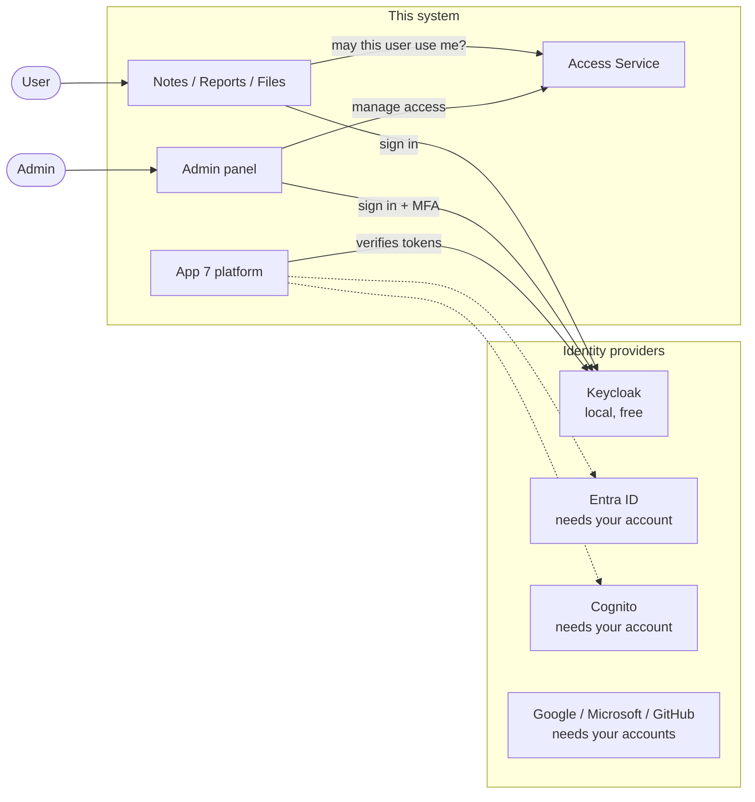
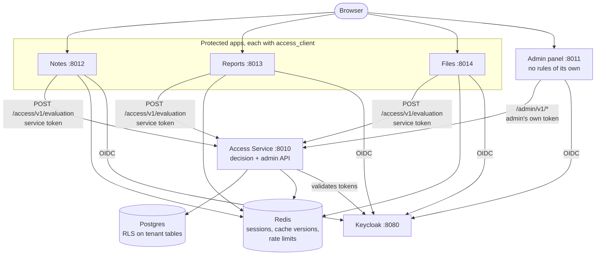
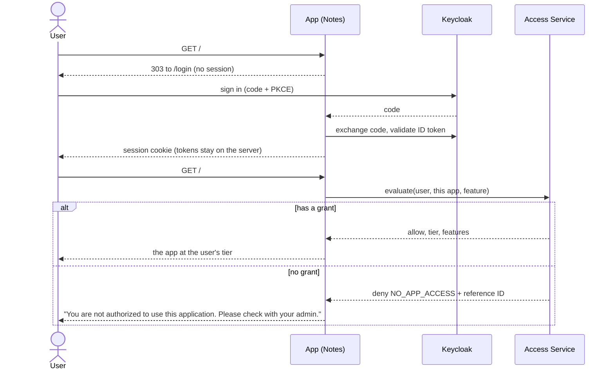
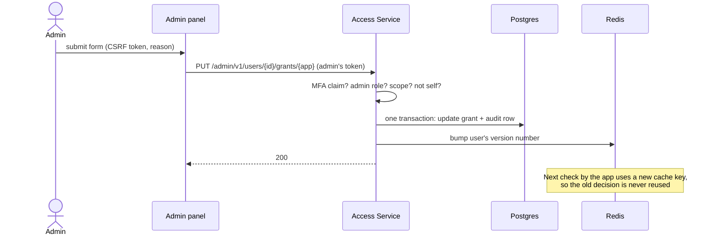
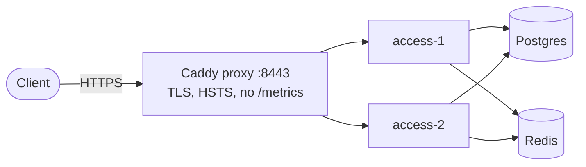

# High-Level Design

Written for: engineers new to this codebase who need the overall picture before reading code.

Diagrams use Mermaid, which GitHub and VS Code render. The low-level detail is in [LLD.md](LLD.md).

## 1. Purpose and scope

A learning platform that implements authentication and authorization the way production systems do, ending in one realistic system:

- **App 7:** a multi-tenant document platform with row-level security and role-based permissions.
- **App 8:** a central **Access Service**, an **admin panel**, and three applications (Notes, Reports, Files) whose access is granted per user at a **Basic, Standard, or Premium** tier.

Apps 1 to 6 and the mTLS lab are focused studies of one topic each. They are listed in section 4.

**Out of scope:** payments, a production deployment, real cloud accounts (Entra ID, Cognito, Google, GitHub were tested against simulated providers only), and a customer-facing frontend.

## 2. Goals and design principles

| Principle | What it means here |
|---|---|
| **Default deny** | No grant means no access. A missing, unknown, or failed check never grants. |
| **Fail closed, and say so honestly** | If the Access Service is down, users see "temporarily unavailable", never "not authorized". |
| **The server decides** | Tiers, roles, and application IDs never come from the browser or from a token claim that a user could influence. |
| **Defense in depth** | Application checks, then Postgres row-level security as a second layer. |
| **Fast revocation** | Changes apply on the next request. Cached decisions are retired by version numbers, with a 30-second cap. |
| **Everything is audited** | Every admin change records who, what, before, after, and why, in the same transaction. |
| **Prove what is rejected** | Each security feature has failure tests, not only success tests. |

## 3. System context

## 4. The applications

| App | Port | Teaches | Phase |
|---|---|---|---|
| `phase1_fundamentals` | 8101 to 8104 | Basic auth, sessions, CSRF | 1 |
| `app1_jwt` | 8001, 8011 (verifier) | JWT, refresh rotation, MFA, passkeys, magic links, API keys | 2, 10, 12 |
| `app2_oidc` | 8002, 8012, 8022 | OAuth 2 and OIDC, device flow | 3 |
| `app3_entra` | 8003, 8013 | Microsoft Entra ID | 4 |
| `app4_cognito` | 8004 | Amazon Cognito | 5 |
| `app5_social` | 8005 | Third-party login and account linking | 6 |
| `app6_sso` | 8006, 8007 (SAML) | SSO, SAML, SCIM, back-channel logout | 7 |
| `app7_platform` | 8008 | Tenants, RLS, RBAC | 8, 9 |
| `mtls_lab` | 8443 | Mutual TLS | 10 |
| `app8_access` | 8010 to 8014 | Application access, tiers, admin panel | 11 |

**Known caveat:** some ports overlap between phases (for example 8011, 8012, 8013, and 8443). Run one phase's servers at a time. The live-check scripts do this for you.

## 5. Main building blocks of App 8

### Roles in the access-control model

These match the standard policy architecture, so the pieces map to terms used in industry:

| Standard term | Here | Job |
|---|---|---|
| Policy Enforcement Point | `access_client` in each app | Applies the decision |
| Policy Decision Point | Access Service | Makes the decision |
| Policy Administration Point | Admin panel + admin API | Changes the rules and grants |
| Policy Information Point | Postgres | Holds users, grants, and tiers |

## 6. Key flows

### 6.1 A user opens an application

### 6.2 An admin changes access

### 6.3 Why revocation is fast

Apps cache decisions in Redis, keyed by `(application, user, feature, version)`. A grant change increments that user's version, so the next request builds a different key and asks the service again. The 30-second expiry is only a backstop if Redis loses an update.

## 7. Data and tenancy

- **Postgres** is the system of record. Three roles are used: an **owner** that runs migrations, an **app** role used at runtime, and a **support** role. None can bypass row-level security.
- **Row-level security** is enabled and forced on every table that carries a `tenant_id`. Each transaction states its tenant with a transaction-local setting, so it cannot leak across pooled connections.
- **Redis** holds sessions, one-time values, cache versions, and rate-limit counters. Keys that belong to a tenant include the tenant.
- **Audit log** is append-only for the application role.

## 8. Security architecture

| Area | Approach |
|---|---|
| Authentication | OIDC with Authorization Code and PKCE. Tokens stay server-side in a Backend-for-Frontend session. |
| Admin sign-in | Requires multi-factor (`amr` contains `otp`), with idle and total session limits and a recent sign-in for sensitive actions. |
| Service-to-service | Client Credentials. Each app may only ask about itself. |
| Token validation | Fixed algorithm list, `iss`, `aud`, `exp`, and a 30-second clock allowance. |
| Tenant isolation | Application checks plus row-level security. |
| Abuse control | Rate limits that reset on their own, with no hard lockout. Per-tenant limits. |
| Web protections | Security headers, size limits, strict CORS, CSRF tokens, safe redirects. |
| Logging | Structured JSON with redaction, and no query strings. |

The full analysis is in [the threat model](../security/threat-model.md).

## 9. Non-functional requirements

| Requirement | Target | Measured |
|---|---|---|
| Revocation reaches a signed-in user | Under 30 seconds | 0.09 seconds, on a quiet system |
| Decision latency, one request at a time | Under 50 ms | 15 ms median |
| Decision throughput, one instance | Plan for growth by adding instances | About 110 per second |
| Availability of decisions | Survive one instance failing | Verified with two instances, with about 1 in 24 requests failing at the moment of failure |
| Failure behavior | Deny and say "unavailable" | Verified |
| Recovery | Restore from backup | Verified into a clean database |

## 10. Deployment view

Containers run as a non-root user with a read-only filesystem and all capabilities dropped. The proxy retries a request on the other instance when one fails. This setup proves TLS, health checks, and failover. Signing in inside containers needs a real Keycloak hostname and has not been tested.

## 11. Technology choices

| Choice | Why |
|---|---|
| FastAPI | Typed, async, and good dependency injection for access checks |
| PyJWT and pwdlib (Argon2id) | What FastAPI's own documentation recommends |
| Keycloak | Free, local, and supports OIDC, SAML, organizations, and MFA |
| Postgres with RLS | Isolation enforced by the database, as a second layer |
| Redis | Fast sessions, one-time values, and cache versions |
| `python3-saml` in a container | Its `xmlsec` dependency is unreliable on Windows |
| Caddy | Simple TLS and health-checked load balancing |

## 12. Key decisions and trade-offs

| Decision | Alternative | Why this way |
|---|---|---|
| Central Access Service | Block at the IdP (Entra "Assignment required") | The IdP shows its own error page, so you cannot show your own message or tiers |
| Tiers in the database | Tiers in the token | A token keeps its value until it expires |
| Tiers as entitlements, checked by feature | Check tier names in code | Changing what Premium includes becomes a data change |
| Version numbers to retire cached decisions | Pub/sub invalidation | A lost message cannot leave a stale decision |
| Shared tables with RLS | Schema or database per tenant | Lowest cost for most B2B products. Stronger isolation is available if a customer requires it |
| Admin panel with no rules | Rules in both places | One place to enforce and audit |
| Rate limiting that fails open | Fail closed | A Redis outage should not block every sign-in |

## 13. Risks and known gaps

See [the threat model](../security/threat-model.md) and [the security self-assessment](../security/asvs-checklist.md). The most important open items:

- No breached-password check, and no secret manager.
- The CI workflow has never run.
- Alert rules are examples that nothing delivers.
- Login throughput was not load-tested.
- Real Entra ID, Cognito, Google, Microsoft, and GitHub flows are untested.
