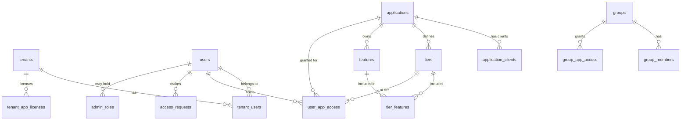
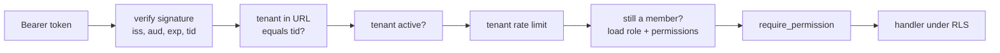

# Low-Level Design

Written for: engineers who will change the code. It focuses on App 8 (the Access Service, admin panel, and protected apps), then App 7, the shared modules, and App 1's token machinery. Read [HLD.md](HLD.md) first.

Paths are relative to the repository root.

## 1. Repository map

```
apps/
  shared/                 hardening.py, rate_limit.py, metrics.py
  app1_jwt/               tokens, keys, store, mfa, passkeys, links, api_keys
  app2_oidc/              oidc.py (reused by later apps), sessions.py
  app7_platform/          auth.py, identity.py, queries.py, migrations/
  app8_access/
    catalog.py            fixed application IDs, tiers, and features
    access_service/       decision.py, core.py, main.py, admin.py, db.py, migrations/
    access_client/        client.py, guard.py, messages.py
    admin_panel/          main.py, templates/
    notes_app/ reports_app/ files_app/
scripts/                  setup, live checks, realm builder
tests/                    one folder per app
deploy/                   Dockerfile, Caddyfile, alerts, compose override
```

## 2. App 8: Access Service

### 2.1 Modules

| Module | Responsibility |
|---|---|
| `decision.py` | Pure decision logic. No database, so every rule is unit-testable |
| `core.py` | Token validation, loading the facts for a decision, user upsert, version bumps |
| `main.py` | `/access/v1/*`, health, and metrics |
| `admin.py` | `/admin/v1/*` and every admin rule |
| `db.py` | Engine, `tenant_tx()`, and query helpers |
| `settings.py` | Configuration, with the `APP8_` prefix |
| `bootstrap_admin.py` | Creates the first Super Admin from the command line |

### 2.2 Data model

All ids are UUIDs. Tables marked RLS carry `tenant_id` and have row-level security enabled and forced.



| Table | Key columns | RLS | Notes |
|---|---|---|---|
| `tenants` | `slug` (unique), `status` | No | `active` or `suspended` |
| `users` | `issuer`, `subject` (unique pair), `email`, `status`, `last_seen_at` | No | Shared across tenants. Never exposed directly |
| `tenant_users` | `tenant_id`, `user_id` | **Yes** | Ties a user to a tenant. Every admin query joins through it |
| `applications` | `id`, `app_key`, `status` | No | `active`, `maintenance`, `retired`. Rows are never deleted, so IDs are never reused |
| `application_clients` | `(issuer, client_id)` primary key, `application_id` | No | Maps an IdP client to an application |
| `tiers` | `application_id`, `key`, `rank` | No | Unique on key and on rank per application |
| `features` | `application_id`, `key` (unique) | No | For example `notes.export` |
| `tier_features` | `tier_id`, `feature_id`, `limit_value` | No | `NULL` limit means unlimited |
| `user_app_access` | `tenant_id`, `user_id`, `application_id`, `tier_id`, `status`, `starts_at`, `expires_at`, `source`, `granted_by`, `reason`, `version` | **Yes** | One non-revoked row per user and app, enforced by a partial unique index. `tier_id` uses `ON DELETE RESTRICT` |
| `groups`, `group_members`, `group_app_access` | tenant, group, user, app, tier | **Yes** | Access through a team |
| `tenant_app_licenses` | `tenant_id`, `application_id`, `tier_id`, `seat_limit`, `expires_at` | **Yes** | Caps tiers and seats |
| `access_requests` | `status`, `requested_tier`, `note`, `reviewed_by` | **Yes** | One open request per user and app, by partial unique index |
| `admin_roles` | `(tenant_id, user_id)`, `role`, `application_id` | **Yes** | Roles below |
| `access_audit_log` | `actor_id`, `action`, `target`, `before`, `after`, `reason`, `reference_id`, `at` | **Yes** | The app role can only `SELECT` and `INSERT` |

**Database roles:** `access_owner` runs migrations, and `access_app` runs the service. Neither is a superuser, and neither has `BYPASSRLS`.

### 2.3 The decision algorithm

`decision.decide(facts, feature, usage)` runs checks in a fixed order, and the first failure wins.

| # | Condition | Reason code | HTTP in apps |
|---|---|---|---|
| 1 | `user.status != active` | `USER_DISABLED` | 403 |
| 2 | `tenant.status != active` | `TENANT_SUSPENDED` | 403 |
| 3 | app status is `maintenance` | `APP_MAINTENANCE` | 503 |
| 4 | app status is anything else non-active | `APP_RETIRED` | 410 |
| 5 | A direct grant is suspended | `ACCESS_SUSPENDED` | 403 |
| 6 | No live grant, and grants exist | `ACCESS_EXPIRED` | 403 |
| 7 | No live grant, and none exist | `NO_APP_ACCESS` | 403 |
| 8 | License rank is below every tier | `NO_APP_ACCESS` | 403 |
| 9 | Feature is not in the tier | `TIER_TOO_LOW` | 403 |
| 10 | `usage >= limit` | `QUOTA_EXCEEDED` | 403 |

**Effective tier.** Start with every non-revoked grant, direct and from groups. Keep the live ones: status `active`, started, and not past expiry (expiry is exclusive, so the exact moment of expiry is denied). Take the highest rank, then cap it at the tenant license's rank, falling to the nearest lower tier. Revoked grants count as no grant.

**Time** always comes from the database clock, so servers cannot disagree about expiry.

### 2.4 Loading the facts

`core.load_facts` runs **one SQL statement** (`FACTS_SQL`) that returns direct grants, group grants, the license, all tiers, and tier features as JSON aggregates. Combined with `upsert_user` skipping its write for someone seen in the last five minutes, a decision is a handful of statements in a single transaction.

### 2.5 Public API (called by apps)

Authenticated with the calling app's Client Credentials token. The token's `aud` must include `access-service`, and its `azp` must map to an application through `application_clients`. The result is cached in memory for 60 seconds.

**`POST /access/v1/evaluation`** follows the shape of the OpenID AuthZEN Authorization API.

```json
{
  "subject":  {"type": "user", "id": "<sub>", "properties": {"email": "...", "issuer": "..."}},
  "resource": {"type": "application", "id": "<application uuid>"},
  "action":   {"name": "use"},
  "context":  {"tenant": "acme", "feature": "notes.export", "usage": 12}
}
```

| Outcome | Response |
|---|---|
| Allowed | `{"decision": true, "context": {"tier": "premium", "features": {...}}}` |
| Denied | `{"decision": false, "context": {"reason_code": "...", "reference_id": "ab12cd34", "tier": "..."}}` |

Rules enforced:

- The `resource.id` must equal the caller's own application, or the call is **403**.
- An unknown tenant or unknown application returns `NO_APP_ACCESS` with no reference, so it reveals nothing.
- A repeated denial for the same user, app, and reason within 60 seconds reuses one reference ID and writes **one** audit row.
- A first-time user is created with no access.

**`POST /access/v1/requests`** creates an access request. Limited to five per hour per user. A duplicate returns the same friendly message.

**`GET /health`** is liveness. **`GET /health/ready`** checks Postgres, and reports Redis as `ok` or `degraded`. **`GET /metrics`** is private, and the proxy returns 404 for it.

### 2.6 Admin API

All routes are under `/admin/v1`, and they take the admin's own access token, not a service token.

**Authentication of the admin** (`admin.current_admin`):

1. The token's `amr` must contain `otp`.
2. The tenant comes from the `organization` claim.
3. The user is created or touched, and must be `active`.
4. An `admin_roles` row must exist.

Authorization table (`ROLE_ACTIONS`):

| Role | view | grant | suspend | manage_apps | manage_admins | audit |
|---|---|---|---|---|---|---|
| `super_admin` | ✅ | ✅ | ✅ | ✅ | ✅ | ✅ |
| `app_admin` | ✅ | ✅ | ✅ | | | ✅ |
| `helpdesk` | ✅ | | ✅ | | | |
| `auditor` | ✅ | | | | | ✅ |

An `app_admin` is further limited to the application on their role row, for every action on that application.

| Route | Needs | Notes |
|---|---|---|
| `GET /whoami`, `/dashboard`, `/users`, `/users/{id}`, `/matrix`, `/applications`, `/groups`, `/requests`, `/reviews` | view | Lists are limited to the admin's tenant by RLS and by `tenant_users` joins |
| `PUT /users/{id}/grants/{app}` | grant | Optimistic locking via `expected_version`, and idempotency via the `Idempotency-Key` header |
| `POST …/suspend`, `POST …/resume`, `POST …/revoke` | suspend, or grant | Each needs a reason |
| `POST /users/{id}/disable`, `POST /users/{id}/erase` | manage_admins | Erase clears personal data and keeps the audit rows |
| `PUT /applications/{id}/status` | manage_apps | `active`, `maintenance`, `retired` |
| `POST /applications/{id}/tiers`, `DELETE …/tiers/{key}`, `PUT …/tiers/{key}/features` | manage_apps | Deleting a tier that is held fails with 409 |
| `POST /groups`, `PUT/DELETE /groups/{id}/members/{user}`, `PUT /groups/{id}/grant` | grant | |
| `POST /requests/{id}/approve`, `POST /requests/{id}/reject` | grant | An open request is locked with `FOR UPDATE` |
| `POST /bulk/preview`, `POST /bulk/apply` | grant | Apply runs in one transaction and needs a recent sign-in |
| `POST /reviews/{grant}/confirm` | grant | |
| `GET /audit`, `GET /audit.csv` | audit | CSV cells starting with `=`, `+`, `-`, `@` are prefixed with `'` |
| `GET/PUT/DELETE /admins/{user}` | manage_admins | `PUT` and `DELETE` need a recent sign-in |

**Cross-cutting rules in `admin.py`:**

| Rule | Where |
|---|---|
| A reason of 3 to 500 characters is required for every change | Pydantic models |
| You cannot change your own access or role | `forbid_self` |
| The last Super Admin cannot be removed | `remove_admin` |
| Sensitive actions need `auth_time` within `reauth_seconds`, or `REAUTH_REQUIRED` is returned | `require_recent_sign_in` |
| A seat limit is enforced under a row lock, so two admins cannot take the last seat | `check_seats` |
| Each change writes an audit row in the same transaction | `audit()` |
| Each change bumps the affected user's cache version, or the global one | `bump_user`, `bump_everyone` |

### 2.7 Sequence: a protected feature call

```mermaid
sequenceDiagram
    participant App as Notes
    participant AC as AccessClient
    participant R as Redis
    participant S as Access Service
    participant D as Postgres
    App->>AC: check(user, "notes.export")
    AC->>R: MGET ver:all, ver:user:{sub}
    AC->>R: GET decision:{app}:{sub}:{feature}:{version}
    alt cache hit
        R-->>AC: cached decision
    else miss
        AC->>S: POST /access/v1/evaluation
        S->>D: BEGIN; set tenant; upsert user; FACTS_SQL
        S->>S: decide()
        S-->>AC: decision
        AC->>R: SET (30 s)
    end
    AC-->>App: context, or raise AccessDenied
```

### 2.8 Failure behavior

| Failure | Behavior |
|---|---|
| Access Service down, slow, or returning an error | `AccessUnavailable`, then a 503 "temporarily unavailable". Never "not authorized" |
| Redis down | Cache and version lookups are skipped, and decisions go to the service. Rate limiting allows requests |
| Postgres down | `/health/ready` returns 503, and the proxy stops sending traffic |
| Audit write fails | The whole change rolls back |
| Revocation message lost | Not possible, as there is no message. The 30-second expiry bounds any Redis problem |

## 3. App 8: access client (`access_client/`)

| Piece | Responsibility |
|---|---|
| `client.AccessClient.check` | Cache lookup, service call, and conversion to `AccessDenied` or `AccessUnavailable`. Quota checks (`usage` given) and `fresh=True` skip the cache |
| `client.ServiceToken` | Client Credentials token, refreshed 30 seconds before expiry |
| `guard.Guard` | Per-app login and logout routes, session handling, exception handlers, and the dependencies `require_app_access()` and `require_feature(feature)` |
| `messages.py` | Reason code to HTTP status and message. `REQUESTABLE` lists reasons where asking an admin helps |

**Behavior contract of `Guard`:**

- The application ID comes from the app's own `AppConfig`, never from a request.
- A browser without a session is redirected to `/login?next=…`. A path that is not local is replaced with `/`.
- `AccessDenied` renders a page with the message, the signed-in email, a **Request access** button where useful, a sign-out button, and the reference ID. It never redirects, so there is no login loop. API clients (`/api/*` or `Accept: application/json`) get RFC 9457 `application/problem+json`.
- `/api/me` validates an access token with `aud` equal to this app's client ID, so a token for another app fails with `WRONG_AUDIENCE`.

**Per-app enforcement:**

| App | Feature checks |
|---|---|
| Notes | `notes.read`, `notes.create` (quota from the live note count), `notes.share`, `notes.export` (rechecked fresh before delivery) |
| Reports | `reports.view`, `reports.export_csv`, `reports.schedule`. A scheduled job rechecks each user and drops those no longer allowed. A WebSocket rechecks every 5 seconds and closes when access ends |
| Files | `files.storage_mb` (quota includes the new upload), `files.folders`, `files.share_links` (HMAC-signed, 5-minute links, with access rechecked on use) |

## 4. App 8: admin panel (`admin_panel/`)

| Concern | Implementation |
|---|---|
| Login | Authorization Code with PKCE. Refuses a token without `otp` in `amr`, and asks the Access Service `whoami` |
| Session | Server-side. 15 minutes idle, 8 hours total, `SameSite=Strict` cookie, access token refreshed quietly |
| CSRF | A per-session token on every form (`check_csrf`) |
| Calling the service | `api()` forwards the admin's token. A `REAUTH_REQUIRED` reply sends the admin to `/login?force=1`, which uses `prompt=login&max_age=0` |
| Failure display | `ApiFailure` shows the service's message on a page with the same status code |
| Output | Jinja autoescape. No JavaScript, and a CSP of `default-src 'none'` that allows forms only to itself and the login server |
| Rules | None. A test fails if role names appear in the panel's source |

## 5. App 7: multi-tenant platform

### 5.1 Data model

| Table | Notes |
|---|---|
| `tenants`, `users`, `user_identities` | A person can sign in through several providers |
| `tenant_idp_connections` | Maps `(issuer, external_tenant_id)` to our `tenant_id` |
| `tenant_domains` | Verified email domains, and whether SSO is enforced |
| `memberships` | `(tenant_id, user_id)`, `role`, `clearance` |
| `projects`, `documents` | Composite primary keys start with `tenant_id`. `documents` has a composite foreign key to its project, so a row cannot point into another tenant |
| `audit_log` | Append-only for the app role |
| `support_grants` | Time-boxed read access for support staff |
| `roles`, `role_permissions` | Roles viewer (10), editor (20), admin (30), owner (40), and the permissions each holds |

### 5.2 Row-level security

```sql
-- app_tenant_id() reads the transaction-local setting.
-- NULLIF is required: after a transaction ends the setting reads '' and ''::uuid raises an error.
CREATE POLICY tenant_isolation ON documents
    USING (tenant_id = app_tenant_id())
    WITH CHECK (tenant_id = app_tenant_id());
```

`database.tenant_transaction(tenant_id, user_id)` opens a transaction and runs `set_config('app.tenant_id', …, true)`. The `true` limits the value to the transaction. A test uses a one-connection pool to prove that nothing carries over.

### 5.3 Request pipeline



All of this runs on **every request**, so removing a member or suspending a tenant works at once, even with a live token.

### 5.4 Identity and sessions

- `identity.TokenVerifier` picks an adapter by the token's `iss`, and the adapter verifies it. Adapters exist for Keycloak, Entra ID, and Cognito. Each yields an `Identity` with a stable `(issuer, subject)`, an external tenant, and the provider's roles.
- `POST /session` swaps a provider token for a 5-minute **tenant token** (RS256) valid for exactly one tenant. A company's own login is mapped to its tenant through `tenant_idp_connections`, and the role is derived from `idp_role_map`.

### 5.5 Permissions

| Permission | Viewer | Editor | Admin | Owner |
|---|---|---|---|---|
| `document:read`, `project:read`, `member:read` | ✅ | ✅ | ✅ | ✅ |
| `document:write_own` | ✅ | ✅ | ✅ | ✅ |
| `document:write`, `project:write` | | ✅ | ✅ | ✅ |
| `document:delete`, `member:manage`, `audit:read` | | | ✅ | ✅ |
| `org:manage` | | | | ✅ |

Extra rules:

- Confidential documents need `clearance >= 1`, which is an attribute check. Others see a 404.
- Missing and forbidden documents both return 404.
- You may not grant or change a role above your own, change your own role, or remove the last owner.
- Support reads only through the `platform_support` database role, and only while a grant is live. Each view is audited.

A route-matrix test runs every role against every route, and a second test fails if a route is added without a test.

## 6. Shared modules (`apps/shared/`)

| Module | Behavior |
|---|---|
| `hardening.apply_hardening(app, csp=…, hsts=…)` | Adds a request ID, security headers, `Cache-Control: no-store`, a body size limit (1 MB default, answered with 413), and one JSON log line per request containing the path only |
| `hardening.redact` | A log processor. Redacts fields whose names suggest secrets, and values that look like JWTs, bearer headers, or API keys |
| `rate_limit.RateLimiter.allow(key, limit, window)` | Fixed-window counter in Redis. Returns `True` if Redis fails |
| `rate_limit.client_ip` | Uses the connection's address. Trusting `X-Forwarded-For` is configured at the server, with `--forwarded-allow-ips` |
| `metrics` | A Prometheus counter, `access_denials_total{reason}` |

Set `LOG_LEVEL` to change the log level, and `hsts=True` only behind HTTPS.

## 7. App 1: token machinery

### 7.1 Access tokens

RS256 JWTs carry `iss`, `aud`, `sub`, `iat`, `nbf`, `exp`, `jti`, `fid` (the session family), and `typ: access`. `verify_access_token` requires them all, uses a fixed algorithm list, and rejects a token whose `typ` is not `access`. After the signature check, `deps.current_claims` rejects a token if:

1. its `jti` is on the denylist (logout),
2. its family is revoked, or
3. it was issued at or before the user's `not_before` time (password reset).

### 7.2 Refresh tokens

Opaque random values, stored as SHA-256 hashes in Redis. Each carries a `family_id`. Using one claims it atomically with `SET NX`. A second use of a claimed token revokes the whole family.

### 7.3 Keys

`KeyRing` keeps several private keys in `.keys/`, named `key-NNNN.pem`. The newest signs. `sync()` runs on each verification, so a key added or retired by another process takes effect without a restart. `rotate_keys --emergency` adds a key and retires all older ones, which is the step in the leaked-key runbook.

### 7.4 Other features

| Module | Behavior |
|---|---|
| `mfa.py` | TOTP secrets encrypted with Fernet. Ten hashed single-use recovery codes. A code works once, using a Redis key per time step. The second step has a five-attempt limit. Step-up checks use a five-minute window |
| `passkeys.py` | WebAuthn through the `webauthn` library. Challenges are single-use. The signature counter is checked for cloning |
| `links.py` | Magic links and password reset use one pattern: random, 15 minutes, single use, stored hashed. The same reply for known and unknown emails, and at most five emails per user per hour. Reset ends every session |
| `api_keys.py` | `ak_<prefix>_<secret>`. Only a hash of the secret is stored. Scopes, expiry, and `last_used_at` are recorded |
| `main.py` | Login is limited per IP, per account, and per pair. `/sessions` lists devices and can end one |

## 8. Configuration

All settings use environment variables with a per-app prefix, through `pydantic-settings`.

| App | Prefix | Notable settings |
|---|---|---|
| App 1 | `APP1_` | `redis_url`, `access_ttl_seconds`, `keys_dir`, `mfa_encryption_key`, `rp_id`, `origin` |
| App 2 | `APP2_` | `issuer`, `client_id`, `client_secret` |
| App 7 | `APP7_` | `database_url`, `support_database_url`, `allowed_origins`, `tenant_requests_per_minute`, `idp_role_map` |
| App 8 | `APP8_` | `database_url`, `redis_url`, `issuer`, `reauth_seconds`, `cache_ttl_seconds` |

Generated values such as Fernet keys change on every restart unless set. Set them explicitly for anything that must survive a restart.

## 9. Local infrastructure

| Service | Port | Notes |
|---|---|---|
| Postgres 17 | 5433 | Databases: `platform`, `platform_test`, `access`, `access_test` |
| Redis 8 | 6380 | Port 6379 is taken by something in WSL. One database number per app |
| Keycloak 26 | 8080 | Realm `course`, built by `scripts/build_realm.py` |
| Mailpit | 1025 and 8025 | Catches all test email |
| SAML app | 8007 | Profile `saml`, runs in a container |

`scripts/reset_realm.py` rebuilds the realm, and `scripts/configure_amr.py` then labels the login steps so `amr` is filled in. Keycloak then returns `["pwd", "otp"]` for an MFA login.

## 10. Testing strategy

| Layer | Approach |
|---|---|
| Unit | Pure logic, such as `decision.py`, runs without services |
| Component | FastAPI test client with a fake identity provider that signs real tokens |
| Database | App 7 and App 8 tests use real Postgres, connecting as the real restricted roles |
| Attack labs | JWT forgery, SAML (in a container), CSRF, and tenant isolation. Every attack must be rejected, and each lab includes a control that proves a correct request passes |
| Live | `scripts/live_phase*.py` start real servers and walk through real flows |

**Why live checks matter:** in this repository each of these passed unit tests and failed live: a login failure from clock drift (1 in 12), a SAML 500 from repeated attributes, an empty `amr` claim, and a cross-tenant leak through the shared `users` table.

## 11. Extending the system

| Task | Steps |
|---|---|
| Add a tier | `POST /applications/{id}/tiers` with a rank between existing ranks. No grants change |
| Change what a tier includes | `PUT /applications/{id}/tiers/{key}/features`. No code change |
| Add a feature | Insert it into `features`, assign it to tiers, and call `require_feature("app.feature")` in the route |
| Add an application | Add it to `catalog.py`, run `setup_access_db.py`, register a Keycloak client with the `access-service` audience mapper, and create the app with `Guard` |
| Add an identity provider to App 7 | Write an adapter that returns an `Identity`, and register it in `TokenVerifier` |
| Add a tenant-owned table | Include `tenant_id`, then enable and force RLS, and add the policy. A test fails if you forget |
| Add a tenant route | Use `require_permission()`, and add it to the route matrix test |

## 12. Known limitations

- The `known_clients` memory is per process, so a newly registered client may take up to 60 seconds to be recognized.
- The user "seen recently" shortcut means a name or email change can take up to five minutes to be stored.
- Rate limiting uses a fixed window, so a short burst is possible at each boundary.
- Per-process state exists in App 6's SAML app (sessions and seen assertions). It must move to a shared store before running more than one instance.
- Port overlaps between phases, described in the HLD.
